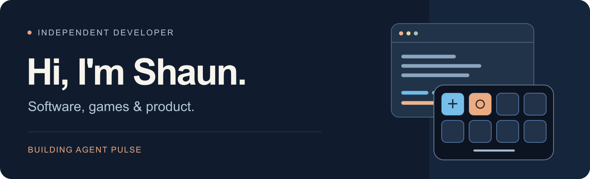

  

**Work inquiries:** [xuwangofficial@gmail.com](mailto:xuwangofficial@gmail.com)

## About me

I'm Shaun (Xu Wang), a developer with an industrial design background and **7+ years in product management, game publishing, and creator platforms**. My career has included roles at ViaX, Sina Weibo, MOONTON Games, and Bilibili, as well as co-founding Doonutsaur Games.

I'm currently pursuing an **M.S. in Computer Science at Northeastern University** (expected December 2027) while building software such as Agent Pulse. My interests span developer tools, games, and movement simulation, combining experience with users and products with hands-on development.

### Selected experience

- **Doonutsaur Games · Co-founder, Product and Publishing · 2024–2026** — Helped bring *Kill the Brickman* to Steam and Xbox, coordinating product planning and releases and contributing Unity/C# gameplay systems.
- **Bilibili · Global Publishing and Product Operations · 2021–2023** — Worked on international game launches, localization, licensed-IP reviews, and coordination across development, publishing, and regional teams.
- **Sina Weibo · Product Management, Creator Growth · 2019–2021** — Worked on creator onboarding, participation incentives, and content programs, collaborating with engineering and analytics on product improvements.

## Featured work

### Agent Pulse

**Your AI agents, at a glance.** A macOS app that turns **Elgato Stream Deck Neo** into a status display for **OpenAI Codex** and **Claude Code**.

Follow task activity, recorded plan progress, and observed working time on your desk. Review each agent's daily history on your Mac.

**[Download on the Mac App Store →](https://apps.apple.com/app/id6815483068)** &nbsp; · &nbsp; [Explore the source](https://github.com/ShaunNYC/streamdeck-ai-monitor) &nbsp; · &nbsp; [Quick start](https://github.com/ShaunNYC/streamdeck-ai-monitor#how-to-use-it)

Interface preview with synthetic demo data. Stream Deck Neo only · Apple Silicon · macOS 13+ · English interface

### What I work with

**C# / Unity** · **Python** · **TypeScript** · **Electron** · **Node.js** · **SwiftUI**

## Get in touch

For job opportunities or project collaborations, reach me at **[xuwangofficial@gmail.com](mailto:xuwangofficial@gmail.com)**.

---

[Browse public repositories](https://github.com/ShaunNYC?tab=repositories) &nbsp; · &nbsp; [Agent Pulse](https://github.com/ShaunNYC/streamdeck-ai-monitor)
